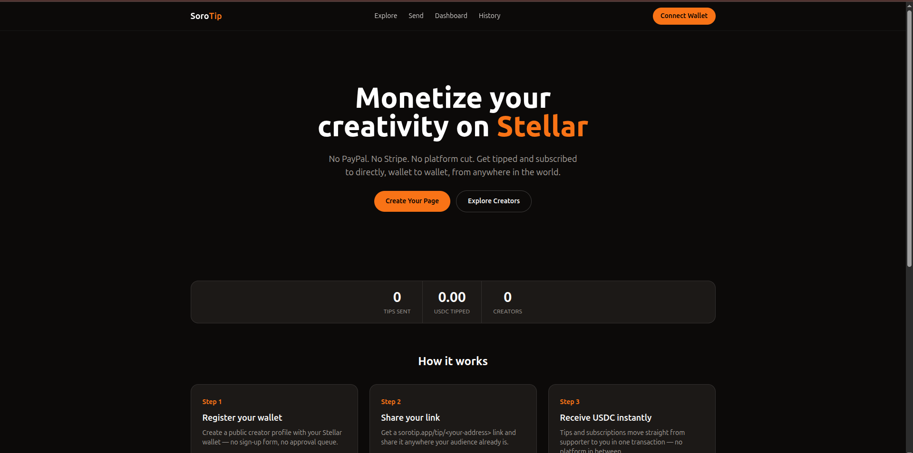

<p align="center">
  
</p>

# SoroTip App

**On-chain tipping and creator monetization frontend for Stellar Soroban**

[](https://nextjs.org/)
[](https://www.typescriptlang.org/)
[](https://tailwindcss.com/)
[](https://stellar.org)
[](./LICENSE)
[](https://drips.network/wave)
[](https://sorotip-app.vercel.app)

## Preview

**Live at [sorotip-app.vercel.app](https://sorotip-app.vercel.app)**



## What is SoroTip

SoroTip is an on-chain tipping and creator monetization protocol on Stellar
Soroban. This app is its web frontend: a public tip page for every creator,
a dashboard for managing your profile and funding goals, and a directory for
discovering creators — all built on [`@sorotip/sdk`](https://www.npmjs.com/package/@sorotip/sdk),
talking directly to the deployed [`sorotip-contracts`](https://github.com/SoroTip/sorotip-contracts)
contract over Soroban RPC. There's no backend and no database — every read and
write goes straight to the chain.

## Tech Stack

- **Next.js 14** (App Router)
- **TypeScript** (strict mode)
- **Tailwind CSS**
- **@sorotip/sdk** — client, Freighter wallet adapter, and React hooks

## Local Setup

```bash
git clone https://github.com/SoroTip/sorotip-app.git
cd sorotip-app
npm install
cp .env.example .env.local
# edit .env.local with your deployed contract's id
npm run dev
```

Without a `Freighter` browser extension installed, wallet-gated pages
(Dashboard, History) will prompt you to connect but read-only pages (creator
profiles, Explore) work immediately.

## Environment Variables

| Variable | Description |
|---|---|
| `NEXT_PUBLIC_STELLAR_NETWORK` | `testnet`, `mainnet`, or `futurenet`. |
| `NEXT_PUBLIC_CONTRACT_ID` | The deployed SoroTip contract's id (`C...`). Required — pages show a "not configured" state until this is set. |
| `NEXT_PUBLIC_RPC_URL` | Soroban RPC endpoint. Defaults to the public testnet RPC if unset. |

## Testing

```bash
npm run lint        # ESLint
npm run typecheck   # tsc --noEmit
npm run build       # production build
npm run test:e2e    # Playwright, 375px viewport, screenshots in test-results/screenshots/
```

All four run in CI on every push/PR to `main` (`.github/workflows/test.yml`) — the
`typecheck, lint, build` job twice: once against no configured contract (the
state a fresh clone starts in) and the Playwright job against a real,
already-deployed testnet contract
([`CBRFZJZIEY5X3YFDU475TM6IPHV6HXWAKXVJMFV6NKWISUH4ZRICN4FR`](https://stellar.expert/explorer/testnet/contract/CBRFZJZIEY5X3YFDU475TM6IPHV6HXWAKXVJMFV6NKWISUH4ZRICN4FR),
public on-chain data, not a secret).

What this verifies: the app builds and typechecks cleanly, `/tip/[address]`
renders without a connected wallet (including the real "creator not found"
state against live RPC), the wallet-gated pages (Dashboard, History) show a
clear connect-wallet prompt instead of erroring, and every page lays out
without horizontal overflow at a 375px viewport (Chromium only — see below).

What this does **not** verify, and is still outstanding:
- A real installed Freighter extension in a real browser.
- Real iOS Safari / Android Chrome rendering — the Playwright suite only has
  Chromium installed here and simulates a 375px viewport with it, not an
  actual WebKit/mobile browser engine.
- Whether the production Vercel deployment at sorotip-app.vercel.app
  currently has `NEXT_PUBLIC_CONTRACT_ID` set to a live contract — the
  screenshot above is genuine (not staged), but was taken in September and
  may not reflect the current production environment variables.

## Contributing via Drips Wave

This repo is part of the [Stellar Wave Program](https://drips.network/wave)
on Drips. Contributors browse open issues, get assigned by the maintainer,
and earn USDC rewards for merged pull requests that resolve an issue. See
[CONTRIBUTING.md](./CONTRIBUTING.md) for the full workflow.

👉 https://drips.network/wave
